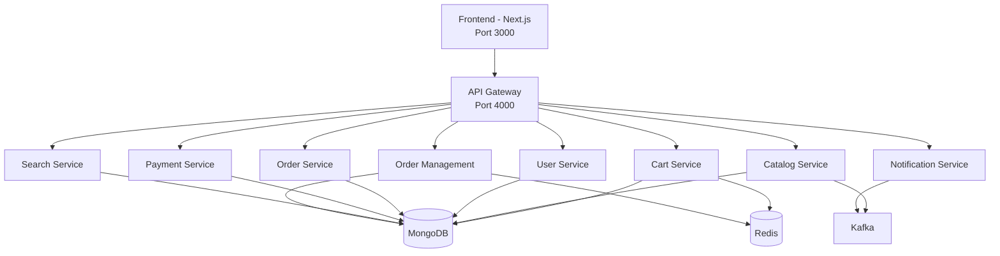

# Docker – ApniDukaan Microservices

Docker configuration and containerization documentation for the ApniDukaan microservices application.

## Overview

The project uses Docker to containerize the frontend and backend microservices, with Docker Compose managing the application stack and supporting infrastructure services.

## Architecture



## Docker Images

| Service | Image | Port |
|---|---|---|
| API Gateway | apnidukaan-api-gateway:v1 | 4000 |
| Cart Service | devops-insights-cart-service:latest | 4005 |
| Catalog Service | apnidukaan-catalog-service:v1 | 4001 |
| User Service | apnidukaan-user-service:v4 | 4002 |
| Order Service | apnidukaan-order-service:v1 | 4003 |
| Payment Service | apnidukaan-payment-service:v1 | 4004 |
| Search Service | apnidukaan-search-service:v1 | 4006 |
| Notification Service | apnidukaan-notification-service:v1 | 4007 |
| Order Management | apnidukaan-order-management-service:v1 | 3002 |
| Frontend | apnidukaan-frontend:v1 | 3000 |

## Supporting Services

| Service | Docker Image |
|---|---|
| MongoDB | mongo:7 |
| Redis | redis:7-alpine |
| Kafka | apache/kafka:4.1.1 |

## Docker Highlights

- Multi-stage Docker builds for production images.
- Containerized frontend and backend microservices.
- Docker Compose orchestration.
- Shared Docker network for service communication.
- Kafka configured in KRaft mode.
- Persistent volumes for MongoDB and Kafka.
- Frontend configured with Next.js standalone output.
- Trivy image vulnerability scanning.

## Validation

- Application images built successfully.
- Docker Compose stack started successfully.
- Kafka broker reached healthy status.
- Kafka producer and consumer messaging tested successfully.
- Frontend returned HTTP 200 on port 3000.
- Trivy scan completed for the API Gateway image.

## Notes

- Application images are currently available locally.
- Images have not yet been published to a container registry.
- Runtime environment variables and secrets must be configured before deployment.
- Dockerfiles remain inside their original service directories.
- The main Docker Compose file remains in the project root.

## Project Structure

```text
DevOps-Insights/
├── backend/
│   ├── api-gateway/Dockerfile
│   ├── cart-service/Dockerfile
│   ├── catalog-service/Dockerfile
│   ├── user-service/Dockerfile
│   ├── order-service/Dockerfile
│   ├── payment-service/Dockerfile
│   ├── search-service/Dockerfile
│   ├── notification-service/Dockerfile
│   └── order-management-service/Dockerfile
│
├── frontend/
│   └── Dockerfile
│
├── Docker/
│   ├── README.md
│   └── images.md
│
├── docker-compose.yml
└── .dockerignore
```
