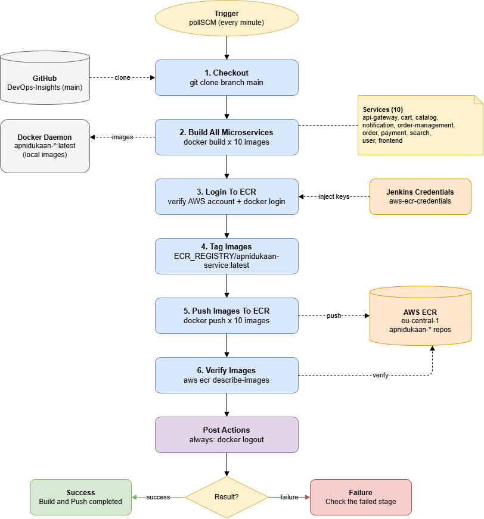

# ApniDukaan – Jenkins CI Pipeline

A declarative Jenkins pipeline that builds Docker images for all ApniDukaan microservices, pushes them to **Amazon ECR**, and verifies that every image landed in the registry.

## Table of Contents

- [Overview](#overview)
- [Pipeline Diagram](#pipeline-diagram)
- [Pipeline Stages](#pipeline-stages)
- [Services](#services)
- [Prerequisites](#prerequisites)
- [Jenkins Setup](#jenkins-setup)
- [Configuration](#configuration)
- [Folder Structure](#folder-structure)
- [Notes and Security](#notes-and-security)

## Overview

| Item | Value |
|------|-------|
| CI tool | Jenkins (Declarative Pipeline) |
| Source repo | [DevOps-Insights](https://github.com/engahmedashraf74/DevOps-Insights) (branch `main`) |
| Container registry | Amazon ECR |
| AWS region | `eu-central-1` |
| Trigger | SCM polling, every minute (`pollSCM('* * * * *')`) |
| Image tag | `latest` |

## Pipeline Diagram

Add a screenshot of the Jenkins Stage View or the draw.io diagram here:



```
GitHub ─► Checkout ─► Build ─► Login to ECR ─► Tag ─► Push ─► Verify ─► Post actions
```

## Pipeline Stages

| # | Stage | Description |
|---|-------|-------------|
| 1 | **Checkout** | Clones the `main` branch from GitHub. Default checkout is disabled (`skipDefaultCheckout`), so the checkout is done explicitly. |
| 2 | **Build All Microservices** | Loops over all services and runs `docker build`. The frontend is built from `frontend/`, and backend services from `backend/<service>/Dockerfile` with the repo root as context. |
| 3 | **Login To ECR** | Loads AWS credentials from Jenkins, checks that the AWS account matches `AWS_ACCOUNT_ID` (fails otherwise), then logs in to ECR. |
| 4 | **Tag Images** | Tags every local image as `<ECR_REGISTRY>/apnidukaan-<service>:latest`. |
| 5 | **Push Images To ECR** | Pushes every tagged image to ECR. |
| 6 | **Verify Images** | Runs `aws ecr describe-images` for each service to confirm the `latest` tag exists in ECR. |

### Post actions

| Condition | Action |
|-----------|--------|
| `always` | `docker logout` from ECR |
| `success` | Prints a success message |
| `failure` | Prints a failure message |

## Services

The pipeline builds and pushes these 10 images (each as `apnidukaan-<name>`):

1. `api-gateway`
2. `cart-service`
3. `catalog-service`
4. `notification-service`
5. `order-management-service`
6. `order-service`
7. `payment-service`
8. `search-service`
9. `user-service`
10. `frontend`

To add a new service, append its name to the `SERVICES` variable and create the matching ECR repository `apnidukaan-<name>`.

## Prerequisites

**On the Jenkins agent:**

- Docker installed, and the `jenkins` user added to the `docker` group
- AWS CLI v2
- Git

**Jenkins plugins:**

- Pipeline
- Git
- Credentials Binding

**On AWS:**

- One ECR repository per service, named `apnidukaan-<service>` in `eu-central-1`
- An IAM user with ECR permissions (`ecr:GetAuthorizationToken`, `ecr:BatchCheckLayerAvailability`, `ecr:InitiateLayerUpload`, `ecr:UploadLayerPart`, `ecr:CompleteLayerUpload`, `ecr:PutImage`, `ecr:DescribeImages`)

## Jenkins Setup

1. Add the AWS credentials: **Manage Jenkins → Credentials → Add Credentials**
   - Kind: `Username with password`
   - Username: AWS Access Key ID
   - Password: AWS Secret Access Key
   - ID: `aws-ecr-credentials`
2. Create the job: **New Item → Pipeline**
3. Under **Pipeline**, choose **Pipeline script from SCM**
   - SCM: `Git`
   - Repository URL: your repo URL
   - Branch: `*/main`
   - Script Path: `Jenkinsfile`
4. Save, then click **Build Now**

## Configuration

Environment variables defined at the top of the `Jenkinsfile`:

| Variable | Description |
|----------|-------------|
| `AWS_REGION` / `AWS_DEFAULT_REGION` | ECR region (`eu-central-1`) |
| `AWS_ACCOUNT_ID` | Expected AWS account, used as a safety check |
| `ECR_REGISTRY` | Full ECR registry URL |
| `AWS_PAGER` | Empty, so the AWS CLI does not open a pager in CI |
| `SERVICES` | Space-separated list of services to build |

## Folder Structure

```
.
jenkins/
 ├── Dockerfile
 ├── Jenkinsfile
 ├── pipeline.png
 └── README.md
```

## Notes and Security

- AWS keys are **never** stored in the Jenkinsfile. They are injected at runtime through Jenkins Credentials (`withCredentials`).
- The account check in the *Login To ECR* stage prevents pushing images to the wrong AWS account.
- All shell blocks use `set -e`, so the build stops at the first failure.
- All images use the `latest` tag. For production, consider also tagging with `${BUILD_NUMBER}` or the Git commit SHA so you can roll back.
- Polling every minute is simple but wasteful. A GitHub webhook is a better trigger.

## Author

Your Name
